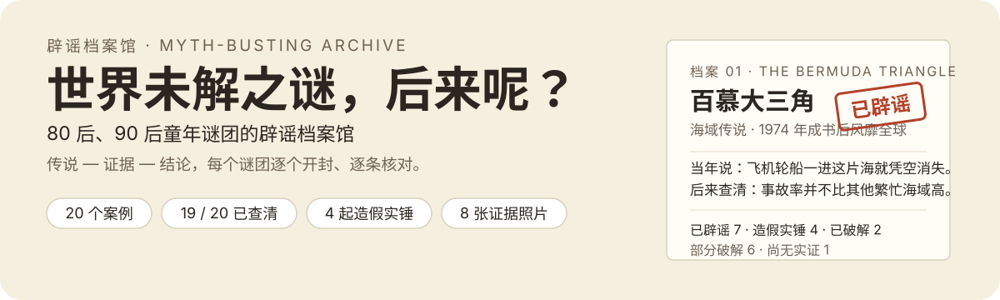
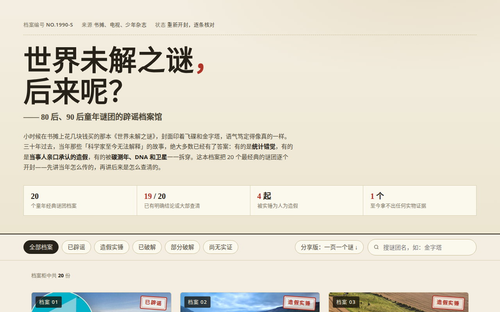
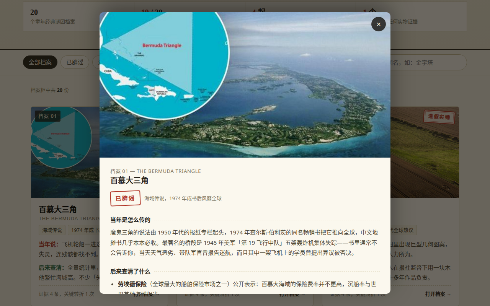

<p align="right"><a href="README.md">中文</a></p>

<p align="center">
  
</p>

<p align="center">
  <a href="https://holynova.github.io/world-unsolved-mysteries/">▶ Live Demo</a>
  ·
  <a href="https://github.com/holynova/world-unsolved-mysteries">GitHub Repository</a>
</p>

A myth-busting archive of 20 classic cases from the "unsolved mysteries" books and TV shows of 1980s–90s China — the Bermuda Triangle, Roswell, the Loch Ness Monster, Stonehenge, the Maya prophecy, the Tunguska explosion and more. Each case follows a "legend — evidence — verdict" structure, with verdicts grounded in published academic research, official investigation reports and museum lab results. Three decades on, 19 of 20 are resolved or largely explained, 4 were proven hoaxes, and only 1 still has no physical evidence at all.

## Screenshots

<p align="center">
  
</p>

<p align="center">
  
</p>

## The 20 Cases

| # | Case | Verdict |
| --- | --- | --- |
| 01 | 百慕大三角 (Bermuda Triangle) | 已辟谣 (Debunked) |
| 02 | 尼斯湖水怪 (Loch Ness Monster) | 造假实锤 (Proven Hoax) |
| 03 | 麦田怪圈 (Crop Circles) | 造假实锤 (Proven Hoax) |
| 04 | 金字塔是外星人建的？ (Were the Pyramids Built by Aliens?) | 已破解 (Solved) |
| 05 | 复活节岛石像 (Easter Island Moai) | 部分破解 (Partly Solved) |
| 06 | 巨石阵 (Stonehenge) | 部分破解 (Partly Solved) |
| 07 | 通古斯大爆炸 (Tunguska Explosion) | 已破解 (Solved) |
| 08 | 亚特兰蒂斯 (Atlantis) | 已辟谣 (Debunked) |
| 09 | 水晶头骨 (Crystal Skulls) | 造假实锤 (Proven Hoax) |
| 10 | 都灵裹尸布 (Shroud of Turin) | 已辟谣 (Debunked) |
| 11 | 野人与大脚怪 (Yeren & Bigfoot) | 尚无实证 (No Evidence Yet) |
| 12 | 罗斯威尔飞碟坠毁 (Roswell UFO Crash) | 已辟谣 (Debunked) |
| 13 | 法老的诅咒 (Curse of the Pharaohs) | 已辟谣 (Debunked) |
| 14 | 玛雅预言：2012 世界末日 (Maya Prophecy: 2012 Apocalypse) | 已辟谣 (Debunked) |
| 15 | 登月是摄影棚拍的？ (Was the Moon Landing Faked in a Studio?) | 已辟谣 (Debunked) |
| 16 | 费城实验 (Philadelphia Experiment) | 造假实锤 (Proven Hoax) |
| 17 | 玛丽·塞莱斯特号幽灵船 (Mary Celeste Ghost Ship) | 部分破解 (Partly Solved) |
| 18 | 天启大爆炸 (Tianqi Explosion) | 部分破解 (Partly Solved) |
| 19 | 湘西赶尸 (Xiangxi Corpse-Driving) | 部分破解 (Partly Solved) |
| 20 | 51 区藏着外星人？ (Are Aliens Hidden in Area 51?) | 部分破解 (Partly Solved) |

Verdicts: 已辟谣 Debunked 7 · 造假实锤 Proven Hoax 4 · 已破解 Solved 2 · 部分破解 Partly Solved 6 · 尚无实证 No Evidence Yet 1.

## Inside Each File

- **当年是怎么传的 (How the legend spread)**: the original version of the tale and how it traveled — which book, which year, which episode became famous.
- **后来查清了什么 (What the evidence showed)**: the evidence item by item — statistics, official investigations, lab tests, and records of hoaxers admitting the fakery.
- **Evidence photos**: 8 key evidence images (e.g. the fake Loch Ness Monster model, the Apollo landing sites photographed by the Lunar Reconnaissance Orbiter).
- **Timeline**: the key events from the legend's birth to its final verdict.
- **Verdict stamp**: five verdict levels — 已辟谣 Debunked / 造假实锤 Proven Hoax / 已破解 Solved / 部分破解 Partly Solved / 尚无实证 No Evidence Yet — filterable on the site.

The site supports filtering by verdict and keyword search, plus a shareable 「分享版：一页一个谜」 ("Share edition: one mystery per page") view, made for forwarding to friends one case at a time. Mobile-first, fully static single page.

## Run Locally

A single `index.html`, no build, no dependencies:

```bash
python3 -m http.server
# Open http://localhost:8000/ — or just double-click index.html
```

## Tech

- Single-file static site: `index.html` (structure + styles + all 20 cases' data + interactions), images in `assets/`.
- Case data is a JS array (20 entries, each with legend, evidence, verdict, and timeline); filtering, search, and detail popups are all computed in the browser, no backend.

```
index.html          Everything: 20 cases / filters / search / detail popups / share edition
assets/             20 case images + 8 evidence photos (ev-*)
```
