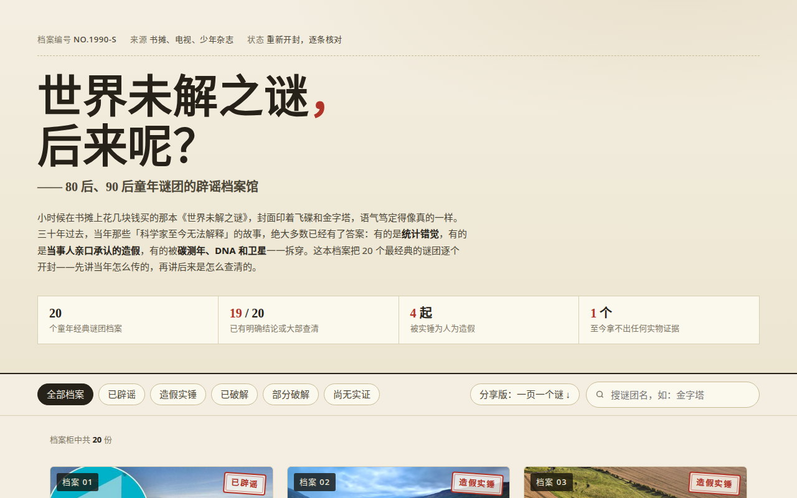
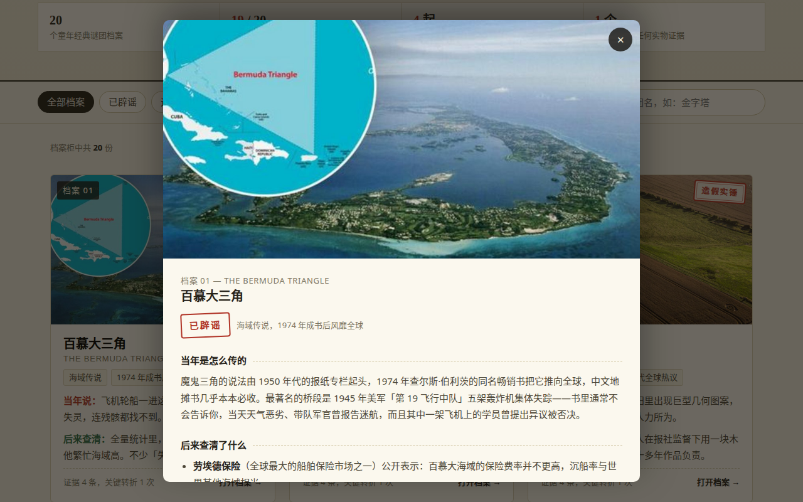

<p align="center">
  
</p>

<p align="center">
  <a href="https://holynova.github.io/world-unsolved-mysteries/">▶ 在线体验 Try Online</a>
  ·
  <a href="https://github.com/holynova/world-unsolved-mysteries">GitHub 仓库</a>
</p>

世界未解之谜是 80/90 后童年谜题的辟谣档案馆：收录 20 个最经典的案例——百慕大三角、罗斯威尔、尼斯湖水怪、巨石阵、玛雅预言、通古斯大爆炸……每个案例按「传说 — 证据 — 结论」三段呈现，结论以公开学术研究、官方调查报告与博物馆检测结果为准。三十年过去，19 个已有明确结论或大部查清，4 起被实锤为人为造假，只有 1 个至今拿不出任何实物证据。

A myth-busting archive of 20 classic cases from the "unsolved mysteries" books and TV shows of 1980s–90s China — the Bermuda Triangle, Roswell, the Loch Ness Monster, Stonehenge, the Maya prophecy, the Tunguska explosion and more. Each case follows a "legend — evidence — verdict" structure, with verdicts grounded in published academic research, official investigation reports and museum lab results. Three decades on, 19 of 20 are resolved or largely explained, 4 were proven hoaxes, and only 1 still has no physical evidence at all.

## 截图 / Screenshots

<p align="center">
  
</p>

<p align="center">
  
</p>

## 20 个案例 / The 20 Cases

| # | 案例 | 结论 |
| --- | --- | --- |
| 01 | 百慕大三角 | 已辟谣 |
| 02 | 尼斯湖水怪 | 造假实锤 |
| 03 | 麦田怪圈 | 造假实锤 |
| 04 | 金字塔是外星人建的？ | 已破解 |
| 05 | 复活节岛石像 | 部分破解 |
| 06 | 巨石阵 | 部分破解 |
| 07 | 通古斯大爆炸 | 已破解 |
| 08 | 亚特兰蒂斯 | 已辟谣 |
| 09 | 水晶头骨 | 造假实锤 |
| 10 | 都灵裹尸布 | 已辟谣 |
| 11 | 野人与大脚怪 | 尚无实证 |
| 12 | 罗斯威尔飞碟坠毁 | 已辟谣 |
| 13 | 法老的诅咒 | 已辟谣 |
| 14 | 玛雅预言：2012 世界末日 | 已辟谣 |
| 15 | 登月是摄影棚拍的？ | 已辟谣 |
| 16 | 费城实验 | 造假实锤 |
| 17 | 玛丽·塞莱斯特号幽灵船 | 部分破解 |
| 18 | 天启大爆炸 | 部分破解 |
| 19 | 湘西赶尸 | 部分破解 |
| 20 | 51 区藏着外星人？ | 部分破解 |

结论分布：已辟谣 7 · 造假实锤 4 · 已破解 2 · 部分破解 6 · 尚无实证 1。

## 每个档案里有什么 / Inside Each File

- **当年是怎么传的**：传说最初的版本与流传路径（哪本书、哪年、哪个桥段最出名）。
- **后来查清了什么**：证据逐条列出——统计数据、官方调查、实验室检测、当事人承认造假的记录。
- **证据照片**：8 张关键证据图（如尼斯湖水怪的造假模型、月球勘测轨道飞行器拍到的登月遗址）。
- **关键事件时间线**：从传说诞生到盖棺定论的节点。
- **结论章**：已辟谣 / 造假实锤 / 已破解 / 部分破解 / 尚无实证，五档结论可筛选。

站内支持按结论筛选与关键词搜索，另有「分享版：一页一个谜」，适合转发给朋友逐个看。手机端优先，纯静态单页。

## 本地运行 / Run Locally

单个 `index.html`，无构建、无依赖：

```bash
python3 -m http.server
# 打开 http://localhost:8000/；或直接双击打开 index.html
```

## 技术 / Tech

- 单文件静态站：`index.html`（结构 + 样式 + 20 条案例数据 + 交互全在里面），图片在 `assets/`。
- 案例数据是 JS 数组（20 条，每条含传说、证据、结论、时间线）；筛选、搜索、详情弹窗均为前端即时计算，无后端。

```
index.html          全部内容：20 个案例 / 筛选 / 搜索 / 详情弹窗 / 分享版
assets/             20 张案例图 + 8 张证据照片（ev-*）
```

## English

**World Unsolved Mysteries** is a myth-busting archive of the 20 cases every Chinese kid in the 80s and 90s read about — Bermuda Triangle, Roswell, Loch Ness, Stonehenge, the Maya 2012 prophecy, Tunguska, and more. Each file tells the legend as it was told, then the evidence that settled it, with verdicts grounded in published research, official reports, and museum lab results.

- **Verdicts**: debunked 7 · proven hoax 4 · solved 2 · partly solved 6 · no evidence yet 1.
- **Inside each file**: how the legend spread, what the evidence actually shows, 8 key evidence photos, and a timeline from first telling to final verdict.
- **Browse**: filter by verdict, search by keyword, or use the shareable one-mystery-per-page view. Mobile-first, fully static single page.
- **Run it**: single-file static site — `python3 -m http.server`, or just open `index.html`.
