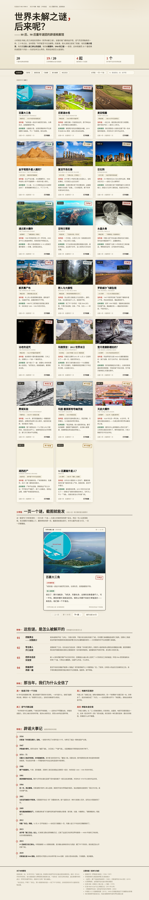

# 世界未解之谜 / World Unsolved Mysteries

中文：80/90 后童年谜题的辟谣档案馆，收录 20 个经典案例：百慕大三角、罗斯威尔、尼斯湖水怪、巨石阵、玛雅预言、通古斯大爆炸等。每个案例按「传说—证据—结论」三段呈现，结论以公开学术研究、官方调查报告与博物馆检测结果为准，标注「已破解」「部分破解」「尚无实证」。附证据照片与关键事件时间线，支持按结论筛选与关键词搜索，手机端优先，纯静态单页。

English: A myth-busting archive of 20 classic cases from the "unsolved mysteries" books and TV shows of 1980s–90s China — the Bermuda Triangle, Roswell, the Loch Ness Monster, Stonehenge, the Maya prophecy, the Tunguska explosion and more. Each case follows a "legend — evidence — verdict" structure, with verdicts grounded in published academic research, official investigation reports and museum lab results, labelled "solved", "partly solved" or "no evidence yet". Includes evidence photos and a timeline of key events. Filter by verdict, search by keyword, mobile-first, fully static single page.



## 在线体验 / Live Demo

- [GitHub Pages](https://holynova.github.io/world-unsolved-mysteries/)
- [GitHub Repo](https://github.com/holynova/world-unsolved-mysteries)


## 本地运行 / Run locally

```bash
python3 -m http.server
```

然后打开 http://localhost:8000/；或直接双击打开 `index.html`。

## 发布 / Deploy

```bash
~/workspace/custom-connectors/custom.legacy-github/bin/gh-push-dir holynova/world-unsolved-mysteries ~/workspace/publish/world-unsolved-mysteries main "Publish world unsolved mysteries"
```

GitHub Pages · 静态托管：`https://holynova.github.io/world-unsolved-mysteries/`
